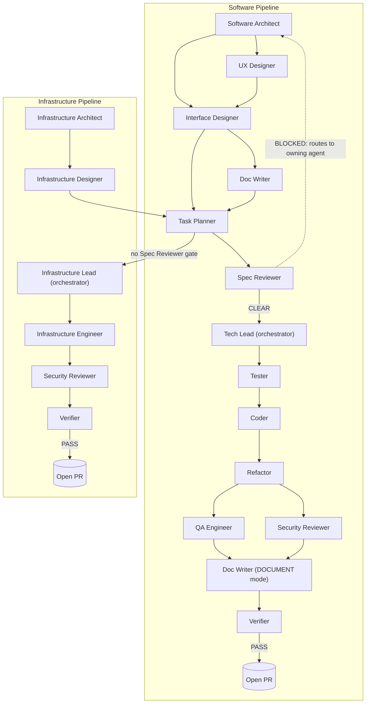

# Agent Pipeline Graph

This graph is generated from the `## Collaboration` block in each agent file. If you add,
remove, or reorder an agent, update that agent's Collaboration block (and the block of
every agent it now hands off to or receives from) and update this diagram to match — the
two must never drift apart.

The Tech Lead and Infrastructure Lead are the only agents that may invoke another agent
directly (via the `Task` tool). Every edge below is a logical artifact handoff, not a
literal subagent call made by the producing agent itself.

## Notes

- **Doc Writer** appears twice in the diagram above (DRAFT mode, between Interface Designer
  and Task Planner; DOCUMENT mode, after AUDIT + SECURITY) because it is one file operating
  in two explicit modes — see `docwriter.md`.
- **QA Engineer** and **Security Reviewer** run in parallel in the software pipeline (both
  gate on the same Refactor output); Security Reviewer is reused standalone in the
  infrastructure pipeline, where there is no QA Engineer phase.
- **Spec Reviewer** only gates the software pipeline. The infrastructure pipeline has no
  pre-implementation spec-review gate (see `infra-lead.md` / `planner.md` Collaboration
  blocks).
