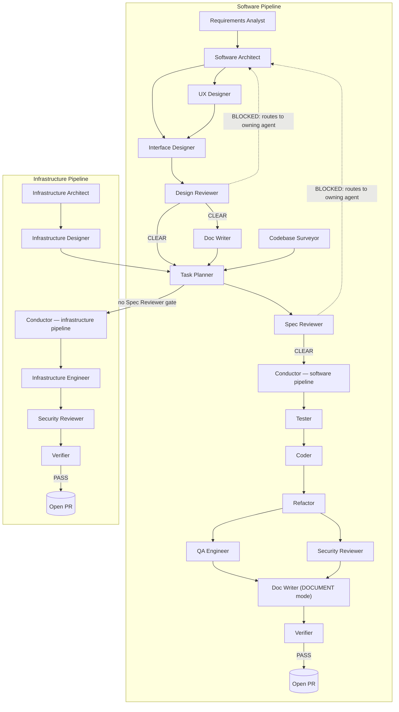

# Agent Pipeline Graph

This graph is generated from the `## Collaboration` block in each agent file. If you add,
remove, or reorder an agent, update that agent's Collaboration block (and the block of
every agent it now hands off to or receives from) and update this diagram to match — the
two must never drift apart.

The Conductor is the only agent that may invoke another agent directly (via the `Task`
tool) — the same agent drives both pipelines below. Every edge below is a logical artifact
handoff, not a literal subagent call made by the producing agent itself.

## Notes

- **Compliance Reviewer** (see #63) is deliberately absent from the diagram above: it is
  not a pipeline phase, isn't gated on every task, and isn't dispatched by `workflow next`.
  The Conductor or a human invokes it ad hoc, naming a specific regulatory framework and
  article; its only output is a new section appended to `docs/spec/constraints.md`, which
  Security Reviewer and Verifier pick up the normal way (as part of the Security Rules
  slice/constraints read already in their own Collaboration blocks) the next time either
  runs — no separate wiring needed.
- **Codebase Surveyor** (see #64) feeds Task Planner for both project types (the edge
  above is drawn once since Planner is one agent serving both subgraphs). It's a
  durable-artifact producer, not a gate: Planner reads `.llm/codebase-survey.md` if it's
  fresh (checked via a recorded git commit timestamp, not a new state file) and only asks
  for a re-run when it's stale or missing.
- **Requirements Analyst** (see #62) is the true entry point of the software pipeline: it
  elicits measurable acceptance criteria, explicit out-of-scope boundaries, and open
  questions into `docs/spec/requirements.md` before the Architect starts proposing *how*.
- **Doc Writer** appears twice in the diagram above (DRAFT mode, between Interface Designer
  and Task Planner; DOCUMENT mode, after AUDIT + SECURITY) because it is one file operating
  in two explicit modes — see `docwriter.md`.
- **Design Reviewer** is the pre-code adversarial gate (see #51): it runs before any test or
  code exists, checking the whole design bundle (architecture, responsibilities,
  assertions, vocabulary, constraints, and the interface spec) for defects that would
  otherwise only surface once the Verifier runs at the very end of the pipeline.
- **QA Engineer** and **Security Reviewer** run in parallel in the software pipeline (both
  gate on the same Refactor output); Security Reviewer is reused standalone in the
  infrastructure pipeline, where there is no QA Engineer phase.
- **Spec Reviewer** only gates the software pipeline. The infrastructure pipeline has no
  pre-implementation spec-review gate (see `conductor.md` / `planner.md` Collaboration
  blocks).
- **Conductor** is one agent (`conductor.md`) driving both pipelines — it appears twice in
  the diagram (once per subgraph) purely for layout clarity, not because it's two agents.
