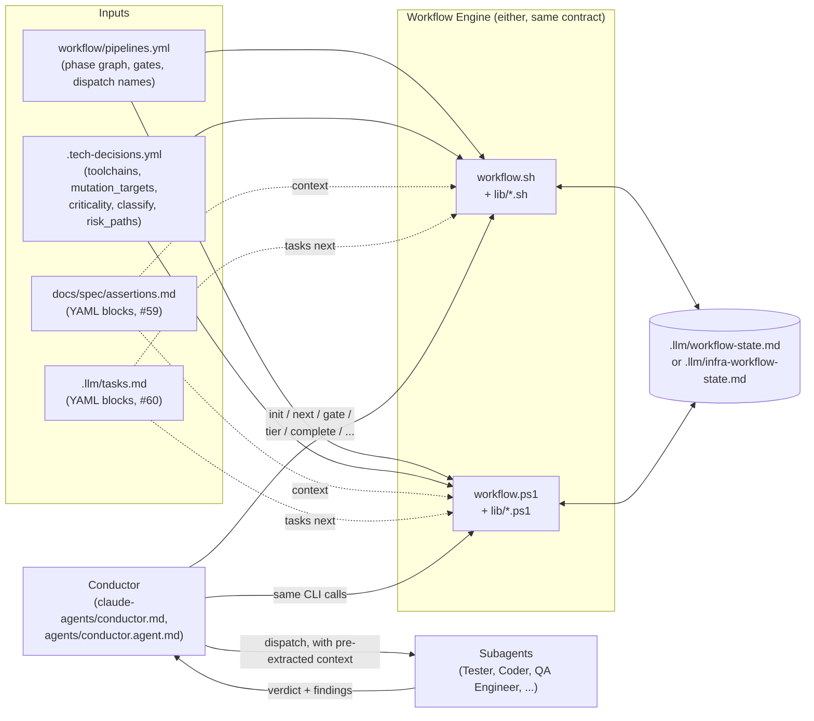

# Workflow Engine CLI

Two implementations of the same contract — `workflow.ps1` (requires the `powershell-yaml`
module: `Install-Module powershell-yaml`) and `workflow.sh` (bash, with a hand-rolled
extractor in `lib/pipeline.sh` scoped to exactly what `workflow/pipelines.yml` needs — not
a general YAML parser). Pick whichever matches your shell; both read the same
`workflow/pipelines.yml` and write the same state-file format, so a task started with one
can be resumed with the other.

All commands print one JSON object to stdout. Errors print `{"error": "..."}` and exit
non-zero.

## How It Fits Together

See also [claude-agents/README.md](../../claude-agents/README.md) for the agent roster
and handoff graph, and [workflow/README.md](../../workflow/README.md) for the phase graph
`pipelines.yml` encodes — this diagram is one level lower: the files and processes that
make the engine itself run.



A task started with one engine can be resumed with the other mid-pipeline — both read and
write the identical state-file format, and neither cares which one wrote what's already
there. Nothing here talks to GitHub or any other external system directly: `onPass:
open-pr` is a value the engine returns, not an action it performs — the Conductor is the
one that opens the PR.

## Task Lifecycle

One task, start to finish, from the Conductor's point of view:

```mermaid
sequenceDiagram
    participant H as Human
    participant C as Conductor
    participant W as workflow CLI
    participant S as State file
    participant A as Subagent

    H->>C: "implement task #42"
    C->>W: init --task 42 --pipeline software
    W->>S: write skeleton, resolve branch
    W-->>C: "{phase, agent, branch, stateFile}"
    C->>S: write Standards / Toolchain / Context (once, skipped on resume)
    C->>W: tier --files-changed N [--path ...] [--untested-module ...]
    W->>S: write Tier, Tier Reason
    W-->>C: "{tier, reason, overridden, rejectedOverride}"

    loop until status is complete
        C->>W: next
        W->>S: read Current Phase, Phases Done, Tier
        W-->>C: "{phases: [{phase, agent}, ...]}"
        par for each phase returned (more than one only in a parallel stage)
            C->>A: dispatch with pre-extracted context
            A-->>C: verdict + findings
            C->>W: gate --phase X --verdict V [--reason ...] [--actual N --target N]
            W->>S: record result; advance past the phase, or pause
            W-->>C: "{result: ADVANCE | PAUSE | FAIL, nextPhase, onPass}"
        end
        alt result is PAUSE or FAIL
            C->>H: relay the finding and the blocking reason
            H->>C: resolve, then resume
        end
    end

    C->>W: complete --task 42
    W->>S: set Status: complete; flip the task's checkbox/status
    W-->>C: "{status: complete, taskMarked}"
    C->>H: summary, and the PR link if the last onPass was open-pr
```

`tier` is optional and can run again later if the task's scope turns out to have grown —
see `tier`'s own section below for the override rules. Every other call in the loop is
mandatory: the Conductor never advances `Current Phase` itself, and never dispatches a
phase `next` didn't just return.

## Commands

### `init --task <id> --pipeline <software|infrastructure> [--slug <slug>]`

Resolves the working branch (create / use / ask, per the branch decision table that used to live in `tech-lead.md` Step 2b (now conductor.md) — see
`workflow/README.md`), writes the state-file skeleton, and returns the first phase:

```json
{"phase": "SPEC_REVIEW_GATE", "agent": "Spec Reviewer", "branch": "task/42-foo", "stateFile": "..."}
```

If the current branch doesn't resolve deterministically (wrong task's branch, or an
unrecognized branch that isn't an integration branch), it instead returns an `ask` payload
and exits `2` — the conductor must resolve this with the human before retrying:

```json
{"action": "ask", "reason": "wrong-task-branch", "currentBranch": "task/41-bar"}
```

`--slug` overrides the branch slug derived from `--task` when creating a new branch.

### `next [--pipeline <name>]`

Returns the phase(s) to run next. Normally one; two when the current stage has parallel
phases (e.g. `AUDIT` + `SECURITY`) and not all of them have gated clean yet:

```json
{"phases": [{"phase": "RED", "agent": "Tester"}], "contextRefs": ["<stateFile path>"]}
```

A `SPEC_REVIEW_GATE`-style conditional phase is skipped automatically (and `next` returns
the phase after it) when its `skipWhen` condition in `pipelines.yml` already holds — see
`workflow/README.md`. Once the pipeline is finished: `{"phases": [], "status": "complete", ...}`.

`--pipeline` is required only when both the software and infrastructure pipelines have an
in-progress state file at once; otherwise the engine infers it.

### `gate --phase <id> --verdict <value> [--reason <value> ...] [--actual <n> --target <n>] [--pipeline <name>]`

Applies the deterministic gate logic and returns one of `ADVANCE | PAUSE | FAIL`:

```json
{"result": "ADVANCE", "nextPhase": "GREEN", "onPass": null}
```

- `--actual`/`--target`: if given and `actual < target`, the result is always `FAIL` —
  **regardless of `--verdict`**. A threshold check cannot be talked past by a verdict string.
- `--reason`: each value must be one of the fixed set documented in `workflow/README.md`
  (`spec-gap`, `blocked`, `safety-critical-survivor`, `formal-counterexample`,
  `critical-finding`, `fail`). Any other value is rejected outright. If a reason matches the
  phase's `pauseWhen` list, the result is `PAUSE` and the reason is recorded under
  `## Blocking Issues` in the state file.
- On `ADVANCE` past a parallel stage (every phase in the group has now gated clean), the
  group's `## Blocking Issues` entries are cleared and `Status` returns to `in-progress`.
- `onPass` surfaces a declared side effect (currently only `open-pr`) for the conductor to
  perform — the engine itself never touches GitHub.

### `complete --task <id> [--pipeline <name>]`

Only succeeds once the pipeline has reached its last phase (state file's `Current Phase` is
the sentinel `DONE`); otherwise it refuses with an error naming the phase still outstanding.
Marks the task's checkbox in `.llm/tasks.md` (`- [ ] <id> ...` → `- [x] <id> ...`) and, if
that id has a structured task record (#60), flips its `status:` field to `done` too — then
sets the state file's `Status` to `complete`.

### `classify [--task <id>] [--path <p> ...]`

Replaces the hand-written Frontend/Backend/Infrastructure prose tables that used to live in
`tech-lead.md` Step 2 and `planner.md`'s old Project Type Detection section (both now
`conductor.md`). Returns:

```json
{"domain": "backend", "paths": [{"path": "docs/spec/interfaces/auth-operations.md", "domain": "backend"}]}
```

`domain` is `frontend`, `backend`, `infrastructure`, or `ambiguous`. Resolution is glob-based
against the `classify:` block in `.tech-decisions.yml` (`frontend:`, `backend:`,
`infrastructure:` — each an inline list of path globs; see the block
`tools/ai-bootstrap/bootstrap-ai-repo.ps1`/`.sh` generate). `--path` can be given directly
(repeatable); `--task <id>` instead scans that task's block in `.llm/tasks.md` for
`docs/spec/...`-looking references and classifies those — a best-effort text scan today,
exact once structured `specRefs` fields exist.

`ambiguous` is returned — never an error — when: no path resolves at all, a path matches
more than one domain's globs, two resolved paths disagree, or `.tech-decisions.yml` doesn't
exist yet. This is deliberate: `ambiguous` is the one case the old prose got right (ask the
human once) and the only case that should still reach one.

### `context --module <name> [--agent <name>] [--task <id>]`

Queries the fenced ```yaml blocks in `docs/spec/assertions.md` (see #59) instead of asking
an LLM to read and filter the file fresh on every task — this is what used to be tech-
lead.md's "extract only the assertions that reference the module(s) this task touches, and
tag each as `[security]` if..." step. Returns:

```json
{"module": "auth", "assertions": [{"id": "ASSERT-0001", "module": "auth", "tags": "[security]", "given": "...", "when": "...", "then": "...", "and": "", "requirementRef": "REQ-0001"}]}
```

- `--module` (required): exact match against each assertion's `module:` field.
- `--agent security-reviewer` (or `"Security Reviewer"`): additionally filters to only
  assertions whose `tags` contains `security` — the subset Security Reviewer gets.
- `--task` is accepted for logging/audit purposes only; module resolution is always via
  `--module`, not derived from the task. Structured task records (#60) carry `domain`, not
  a module name matching `assertions.md`'s `module:` field, so this still isn't automatic.
- Returns `{"module": "...", "assertions": []}` — never an error — when the file doesn't
  exist, or nothing matches `--module`.

### `tasks next`

Queries the fenced ```yaml task blocks in `.llm/tasks.md` (see #60) instead of hand-
sequencing the task list — this is what used to be planner.md's "Core/shared types →
Domain types → Port interfaces → ..." prose. Returns the first task (in file order) that
isn't `done`/`blocked` and whose every `deps` entry is `done`:

```json
{"task": {"id": "1.1", "title": "Domain types", "deps": "1.0", "criticality": "domain_logic", "specRefs": "...", "status": "ready", "domain": "backend"}}
```

- `{"task": null, "reason": "none-ready"}` when every task is done or every remaining task
  is blocked on something not yet done.
- `{"task": null, "reason": "cycle-detected", "cycle": "1.0 -> 1.1 -> 1.0"}` if `deps` forms
  a cycle anywhere in the file — checked across the whole graph before picking a task, not
  just the one that happened to be selected, so a cycle elsewhere can't hide behind an
  unrelated ready task.
- `{"task": null, "reason": "no-tasks-file"}` / `"no-structured-tasks"` when `.llm/tasks.md`
  doesn't exist, or exists but has no yaml blocks yet (pre-#60 prose-only file).

`workflow complete` (above) also flips a matching task record's `status` to `done`
alongside the prose checkbox it already updated.

If `docs/spec/assertions.md` predates this schema (prose only, no yaml blocks), run
`tools/workflow/migrate-assertions.ps1`/`.sh` once to back-fill them — idempotent, safe to
run again on a partially-migrated file.

### `tier --files-changed <n> [--path <p> ...] [--untested-module <m> ...] [--override <tier>] [--pipeline <name>]`

Computes the task's risk tier deterministically (see #61 — three fixed tiers, not AWS's
weighted composite) and records it on the active pipeline's state file for every later
`gate`/`next` call to read. Returns:

```json
{"tier": "elevated", "reason": "touches a risk_paths-tagged path", "overridden": false, "rejectedOverride": null}
```

- **minimal**: `--files-changed` is `<=3`, no `--path` matches `.tech-decisions.yml`'s
  `risk_paths:` glob list, and no `--untested-module` was given.
- **elevated**: any `--path` matches `risk_paths:`, OR `--files-changed` is `>15`, OR any
  `--untested-module` was given — checked in that order, so the reason reported is always
  the first one that applies.
- **standard**: everything else.
- `--override <tier>`: a human can move the tier up at any time — `overridden` becomes
  `true` and `reason` records the natural tier it moved from. Moving it *down* out of an
  **elevated** tier triggered by a `risk_paths` match is refused outright (not just
  discouraged): `tier` stays `elevated`, `overridden` stays `false`, and
  `rejectedOverride` carries the refusal message. This is a hard rule, not a default —
  there is no flag that bypasses it.
- Requires an active, unfinished pipeline (same resolution as `gate`/`next`/`complete`) —
  the tier is written into *that* task's state file as `**Tier:**` / `**Tier Reason:**`.
- A phase's `skipOnTier` list in `pipelines.yml` (see `workflow/README.md`) is checked
  lazily by `next`, not by `tier` or `gate` — `gate` always advances to the next phase in
  sequence regardless of tier; it's the *next* `next` call that marks a `skipOnTier`-listed
  phase done without dispatching its agent, before returning what's still pending. Run
  `tier` any time before the phase it should affect is first requested via `next`.

## State file

Both engines read/write a fixed machine-managed header (`**Task:**`, `**Pipeline:**`,
`**Branch:**`, `**Current Phase:**`, `**Phases Done:**`, `**Status:**`, plus `**Tier:**` /
`**Tier Reason:**` once `tier` has been run — see above) plus `## Existing Work` and
`## Blocking Issues` sections they append to. Everything else in the
file — `## Standards`, `## Toolchain`, `## Context`, etc. — is written by the Conductor,
never by this engine; `init` writes those sections as empty placeholders and leaves them
alone afterward. `## Context`'s internal shape is deliberately not the engine's concern —
it differs by pipeline (software vs. infrastructure need different slices); see
`claude-agents/conductor.md` Step 2 for what the Conductor writes there.

## Testing

`test/test-workflow.sh` and `test/test-workflow.ps1` are self-contained, dependency-free
(no Pester, no bats) — they actually run the engine against disposable scratch git repos,
mirroring the convention in `tools/ai-bootstrap/test/`. Run them directly:

```bash
bash tools/workflow/test/test-workflow.sh
pwsh tools/workflow/test/test-workflow.ps1
```

Both must report 0 failures before any change to `workflow.ps1`, `workflow.sh`, or either
`lib/` file is considered done — they're kept in strict scenario-for-scenario parity.
