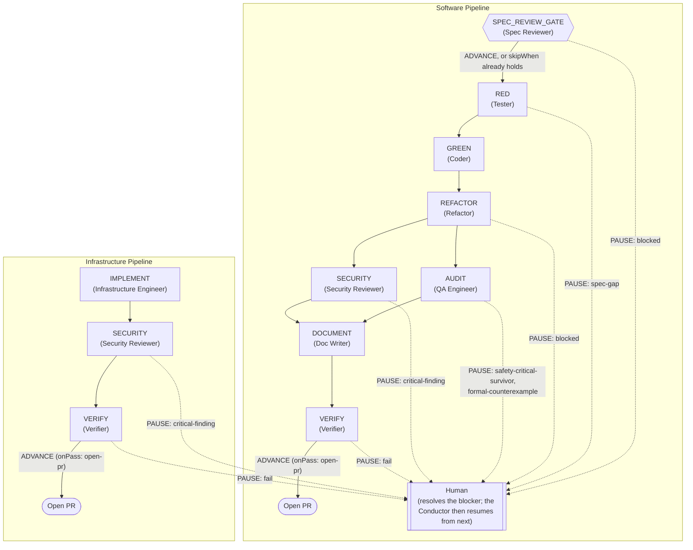

# Workflow Pipeline Schema

`pipelines.yml` in this directory is the single source of truth for phase order, gate
conditions, and subagent dispatch names, consumed by the workflow engine in
`tools/workflow/` (see #55). It replaces the branch-decision table, phase-gate logic, and
dispatch table that used to live as prose inside `claude-agents/tech-lead.md` and
`claude-agents/infra-lead.md` — both deleted (#57), replaced by
`claude-agents/conductor.md`, which reads this schema via the engine rather than encoding
it itself.

## Phase Flow

For *who hands off which artifact to whom*, see
[claude-agents/README.md's Agent Pipeline Graph](../claude-agents/README.md) instead —
this diagram is the engine's phase-execution shape, not the agent roster.

The diagram below is the actual shape `pipelines.yml` encodes today — every solid arrow is
an `advance: auto` transition (or a satisfied `skipWhen`), every dashed arrow is a
`pauseWhen` reason routing to the human instead of auto-advancing, and `AUDIT`/`SECURITY`
fork from `REFACTOR` and join back into `DOCUMENT` because they share a `parallelWith`
entry — `workflow next` won't return the phase after either until *both* have gated clean.



**Shortcuts not drawn above** (both skip invoking the phase's `agent` entirely, not just
auto-advancing past it):

- `SPEC_REVIEW_GATE` is skipped — straight to `RED` — when a fresh `CLEAR` spec-review
  report already exists (`skipWhen`, see below).
- Under `tier: minimal` (see `workflow tier` in `tools/workflow/README.md`), `AUDIT` and
  `DOCUMENT` are each marked done without dispatching their agent (`skipOnTier`). This is
  checked lazily by `next`, not by `gate` — a `gate` call on `REFACTOR` still advances
  `Current Phase` to `AUDIT` in the state file exactly as drawn; it's the *following*
  `next` call that notices the tier, marks `AUDIT` done unseen, and returns `SECURITY`
  (or `VERIFY`, once `DOCUMENT` is skipped the same way) instead.

## Top-level shape

```yaml
pipelines:
  <pipeline-name>:
    stateFile: <path>       # markdown state file this pipeline reads/writes
    branchPrefix: <string>  # e.g. "task/" or "infra/task/"
    branchRules: [...]      # optional; software-only today, see below
    phases: [...]
```

## `branchRules` (list, evaluated top to bottom, first match wins)

Mirrors the branch decision table that used to live in `tech-lead.md` Step 2b (now conductor.md). Each entry:

| Key | Meaning |
|---|---|
| `match` | current branch pattern(s) to test, e.g. `"task/{slug}"` or a list of literal integration-branch names |
| `sameTask` | (only on `task/{slug}` patterns) whether `{slug}` matches the task being resolved |
| `action` | `use` (stay on this branch), `create` (switch to a new branch per `branch`), or `ask` (stop and ask the human) |
| `branch` | template for the branch to create, when `action: create` |
| `reason` | short machine-readable reason passed to the human when `action: ask` |

A pipeline with no `branchRules` (the infrastructure pipeline today) means the engine
does not manage branch resolution for it — add the block if that changes.

## `phases` (list, in execution order)

| Key | Meaning |
|---|---|
| `id` | phase identifier, matches the `## Current Phase` value written to the state file |
| `agent` | exact dispatch name — must match the target agent's `name:` field verbatim |
| `advance` | `auto` (proceed once the agent returns, subject to `pauseWhen`), or `conditional` (see `skipWhen`) |
| `pauseWhen` | list of reason strings (below) that force a human gate instead of auto-advancing |
| `parallelWith` | list of phase `id`s that run concurrently with this one; both must clear before the engine advances past either |
| `skipWhen` | (only with `advance: conditional`) conditions under which the engine auto-advances *without* invoking `agent` at all |
| `skipOnTier` | list of risk tiers (see #61, `workflow tier`) for which this phase is auto-marked done without invoking `agent` — unconditional, unlike `skipWhen`; checked by `next` before every phase it would otherwise return |
| `onPass` | side effect to run when this phase's gate passes with no blocking reasons; currently only `open-pr` is defined |

### `pauseWhen` reason strings

These are the only reason strings the engine recognizes; `workflow gate` rejects any
other value rather than silently treating it as a pass-through.

| Reason | Meaning |
|---|---|
| `spec-gap` | the Tester could not write a test because the spec is ambiguous or incomplete |
| `blocked` | the agent returned a `BLOCKED` verdict (Spec Reviewer, Refactor) |
| `safety-critical-survivor` | a mutation survivor exists in a module classified `safety_critical` |
| `formal-counterexample` | Tier 6 formal verification returned `COUNTEREXAMPLE`/`FAIL` |
| `critical-finding` | Security Reviewer filed a Critical-severity finding |
| `fail` | the Verifier returned `FAIL` |

### `skipWhen` (SPEC_REVIEW_GATE only, today)

```yaml
skipWhen:
  reportVerdict: CLEAR
  reportNewerThan: docs/spec/
```

Both conditions must hold for the engine to skip invoking the agent: the most recent
`.llm/spec-review/*.md` report's verdict must equal `reportVerdict`, and its mtime must
be newer than the latest change under the path named by `reportNewerThan` (resolved via
`git log -1 --format=%cI -- <path>`, same check that used to live in `tech-lead.md` Step 1a (now conductor.md).

## Scope boundary

This file covers only the TDD execution pipelines the Conductor actually dispatches. The upstream spec-authoring chain (Requirements Analyst → Software Architect → Interface
Designer → Design Reviewer → Doc Writer DRAFT mode / Task Planner) has no single
orchestrating agent today — each step is invoked directly by the human or via a Copilot
handoff — so it is not represented here. If a future agent takes over orchestrating that
chain, it gets its own pipeline entry at that point, not a retrofit of this one.
