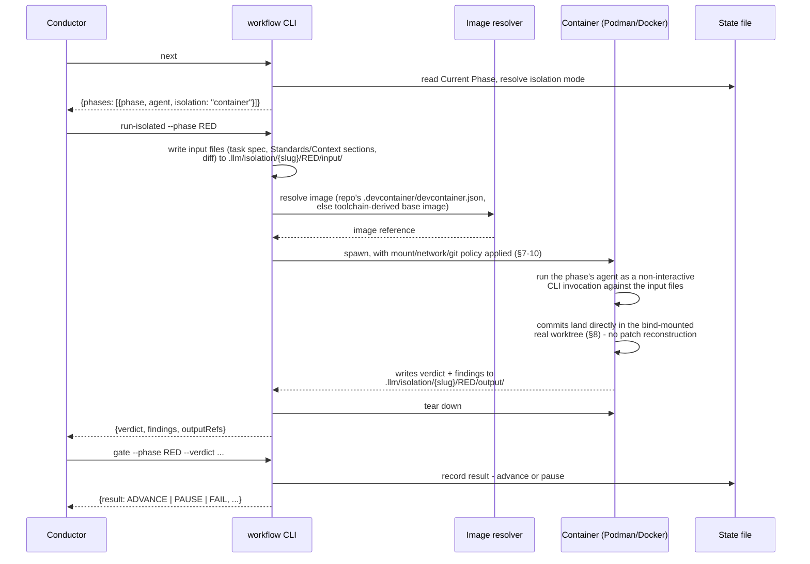

# Isolation — Design Spec

**Status:** Draft, ready for review. Supersedes-in-spirit `.llm/plans/isolation.md`
(the decision log that produced this — kept as the historical record of *why*, not
duplicated here).
**Scope:** Extends the workflow engine (`tools/workflow/`, `workflow/pipelines.yml`,
`.tech-decisions.yml`) described in [workflow/README.md](./README.md) with a
per-phase isolation boundary. Read that file first — this one assumes its schema
and CLI contract as a starting point and only describes the delta.
**Implementation status (2026-10-22):** §4, §5, §7, §8, §9, §10's narrowing-to-
touched-paths, and §11's resolved baseline are implemented — `pipelines.yml`'s
`isolation` key, `.tech-decisions.yml`'s `isolation` block, `workflow next`'s
extended response, and the new `workflow isolation --override` command all exist
and are tested. **§3's container lifecycle (`workflow run-isolated` itself) is
not implemented** — spawning the sandbox, materializing input/output files,
enforcing the mount/network/git policy at runtime, and devcontainer resolution
(§12) are deferred, primarily because §9's network-allowlist enforcement needs a
real mechanism decision (a forward-proxy sidecar vs. iptables/DNS filtering) that
this spec doesn't settle. Until that lands, a phase resolving to `container` has
nowhere to actually run — `next` reports the resolved mode correctly, but nothing
yet acts on it.

## 1. Goals and threat model

Isolation exists to contain three things at once, and to make a specific tradeoff
safe in exchange:

- **Buggy subagent damage** — an unintended destructive command, a test that hits a
  real external service instead of a mock, an overwrite outside the intended scope.
- **Adversarial content in the target repo** — this tooling's agents run against
  arbitrary repos this project doesn't control. A planted file, commit message, or
  branch could attempt to manipulate a subagent into harmful action (prompt
  injection) or simply *be* the harmful action once executed (a malicious build
  script).
- **Supply-chain risk from invoked tooling** — a package manager install, linter, or
  build tool run during a phase executes code this project never wrote and can't
  review in advance (postinstall scripts, compromised registries).

The tradeoff this buys: because worst-case damage per phase is bounded by a real
enforced boundary — not a tool-allowlist convention — the Conductor can be trusted
with more autonomy than it has today: fewer `pauseWhen` gates for pure process-risk
concerns, longer unattended runs, and tool/network grants that would be unsafe to
hand a fully-trusted-by-default subagent.

**The boundary must hold even when the agent itself is fully convinced to do the
wrong thing.** It cannot rely on the subagent's own cooperation, and it cannot rely
only on restricting which Claude Code tools are exposed to the model — a malicious
`postinstall` script run by `npm install` never goes through a Claude Code tool call
at all, so a tool allowlist can't contain it. This is why the mechanism is a real
sandbox (§3), not an extension of the `tools:`/`disallowedTools` allowlists that
already exist on every agent file — those remain in place and complement this, they
don't substitute for it.

## 2. Non-goals (explicitly deferred, not forgotten)

- **Resource quotas** (CPU/memory/disk/wall-clock limits). A reliability/cost
  concern, not a security one — worth having, tracked as follow-up, not required
  for the boundary this spec establishes.
- **Dotfile/secret-path exclusion within the repo itself** (e.g. hiding `.env`,
  `.git/config` from read access even inside the task's own worktree). A future
  tightening of §10's filesystem policy, not required for a first version.
- **Fine-grained per-call auditing of commands run inside the sandbox.** The
  boundary is preventive (deny by default), not detective. Logging/audit of what
  actually ran is useful but is a separate feature.

## 3. Architecture

### 3.1 Two dispatch paths, selected per phase

Every phase resolves to exactly one of:

- **`direct`** — unchanged from today. The Conductor dispatches the phase's agent
  via the `Task` tool, in-process, sharing the Conductor's own session. This is
  "no change" for `SPEC_REVIEW_GATE`, `SECURITY`, `DOCUMENT`, `VERIFY` (software) and
  `SECURITY`, `VERIFY` (infrastructure).
- **`container`** — the phase does **not** go through the `Task` tool at all. The
  workflow engine itself — a script, not an LLM decision — materializes the phase's
  inputs to files, spawns a sandboxed, non-interactive agent invocation inside a
  container, waits for it to finish, and reads its outputs back from files. The
  Conductor's role for a `container` phase shrinks to "ask the engine to run this
  phase and wait," exactly the same shape as it already asks the engine `next`/
  `gate` questions — it is not told *how* that happened, only the result.

This second path is what actually satisfies "no LLM for orchestration" for the
phases that need it: the thing deciding to spawn the subagent and tearing it down
afterward is the engine's own script, not the Conductor reasoning about whether to
call `Task`.

### 3.2 Sequence for a `container` phase



`direct` phases skip all of this and keep today's sequence exactly
(`workflow/README.md`'s existing diagram) — the Conductor dispatches via `Task`
directly, no new file layout, no container.

### 3.3 Why the real worktree is bind-mounted, not copied

The container mounts the task's **actual** git worktree, not an ephemeral copy. A
subagent's commits inside the container are real commits in the real history,
preserving this repo's commit-per-phase and commit-message-format discipline. This
was chosen over having the subagent emit a patch for the host to re-apply, because
the patch approach costs real complexity (reconstructing commit granularity and
messages) for a security gain the credential-stripping and network-denial layers
(§7, §9) already provide without it — `git push` is blocked whether or not the
container ever touched the real worktree directly.

## 4. Phase isolation defaults

Shipped as the baseline in `pipelines.yml` itself (§5.1) — every repo gets these
unless it opts out via `.tech-decisions.yml` (§5.2). See §11 for why this baseline
being the *shipped default* rather than an opt-in needs a decision before release.

| Software pipeline phase | Default | Why |
| --- | --- | --- |
| `SPEC_REVIEW_GATE` | `direct` | Read-only review, no target-repo tooling executed |
| `RED` (Tester) | **`container`** | Writes and runs tests against the target repo's own toolchain |
| `GREEN` (Coder) | **`container`** | Executes arbitrary code/build/install against the working tree |
| `REFACTOR` (Refactor) | **`container`** | Same as GREEN |
| `AUDIT` (QA Engineer) | **`container`** | Runs mutation/fuzz tooling, installs test dependencies |
| `SECURITY` (Security Reviewer) | `direct` | Read-mostly review |
| `DOCUMENT` (Doc Writer) | `direct` | Read-mostly, no toolchain execution |
| `VERIFY` (Verifier) | `direct` | Read-mostly review |

| Infrastructure pipeline phase | Default | Why |
| --- | --- | --- |
| `IMPLEMENT` (Infrastructure Engineer) | **`container`** | Runs `terraform plan`/`apply`, downloads provider plugins, runs `tflint` against potentially tainted inputs |
| `SECURITY` (Security Reviewer) | `direct` | Read-mostly review |
| `VERIFY` (Verifier) | `direct` | Read-mostly review |

## 5. Configuration schema

### 5.1 `pipelines.yml` — per-phase baseline

Each phase entry gains one new key, `isolation`, defaulting per §4:

```yaml
phases:
  - id: RED
    agent: "Tester"
    advance: auto
    pauseWhen: [spec-gap]
    isolation: container   # new — this repo's shipped baseline
```

A phase with no `isolation` key defaults to `direct` — this only needs to be
written explicitly for the five phases in §4 that default to `container`.

### 5.2 `.tech-decisions.yml` — repo-level policy

A new top-level `isolation:` block:

```yaml
isolation:
  mechanism: podman        # optional; "podman" (preferred) or "docker". Engine
                            # detects whichever is installed if omitted.
  overrides:                # repo-level phase-default overrides — committed,
    RED: direct              # reviewable. Can move a phase EITHER direction
                              # at this level (unlike the task-level override
                              # in §5.3, which can only strengthen).
  network:
    allow: []                # additional egress allowlist entries beyond the
                              # toolchain-derived defaults (§9)
```

`overrides` is the only place a phase's `container` default can be weakened to
`direct` — a committed, reviewable config change, never a runtime flag. This is
the repo maintainer's call, not an individual task's.

### 5.3 Task-level override — asymmetric, mirrors `workflow tier --override`

A new command:

```
workflow isolation --phase <id> --override <container|direct> [--pipeline <name>]
```

Resolves the phase's current baseline (pipelines.yml default, after
`.tech-decisions.yml`'s `overrides`), then:

- Requested `container` where the resolved baseline is `direct` → **allowed**
  (strengthening). Recorded in the state file.
- Requested `direct` where the resolved baseline is `container` → **refused
  outright**, same posture as `workflow tier --override`'s refusal to move below
  an `elevated` floor:

  ```json
  {"error": "cannot downgrade RED below repo policy (container)", "rejectedOverride": "direct"}
  ```

  The only way to actually weaken it is editing `.tech-decisions.yml`'s
  `overrides` block — see §5.2.

### 5.4 `workflow next` — extended response shape

```json
{"phases": [{"phase": "RED", "agent": "Tester", "isolation": "container"}]}
```

One new field per phase entry; everything else about `next`'s contract is
unchanged. The Conductor branches on this field: `direct` → dispatch via `Task` as
today; `container` → call `workflow run-isolated` (§3.2) instead.

### 5.5 State file — new per-phase record

Alongside the existing `**Tier:**`/`**Tier Reason:**` lines, one new section
tracking resolved isolation mode per phase and why:

```markdown
## Isolation
RED: container (repo default)
GREEN: container (repo default)
REFACTOR: direct (task override: 2026-10-21, requester judged low risk)
```

Written by the engine on `next`/`run-isolated`, never by the Conductor directly —
same division of responsibility as `Current Phase`/`Phases Done` today.

## 6. `workflow run-isolated` — the new command

```
workflow run-isolated --phase <id> [--pipeline <name>]
```

Only valid when the resolved isolation mode for `<id>` is `container`. Performs the
full sequence in §3.2: materializes input files, resolves the image, spawns the
container with the policy from §7–§10 applied, waits for the subagent's output
files, tears down, and returns:

```json
{"verdict": "CLEAR", "findings": [...], "outputRefs": [".llm/isolation/42-foo/RED/output/"]}
```

On a missing runtime (§11) or a policy violation detected during the run (e.g. the
subagent's git wrapper rejected a denied command), returns a non-zero exit and a
structured error — never a silent `direct` fallback.

## 7. Credential and secret handling

Never mounted or passed into the container, regardless of what the host session
has available: `.git-credentials`, SSH private keys and `known_hosts`,
`GITHUB_TOKEN`/`GH_TOKEN`/`GH_PAT`-shaped environment variables, `gh` CLI auth
state, any cloud-provider credential files (`~/.aws`, `~/.azure`, provider env vars
for the infrastructure pipeline). This is independent of and redundant with the
network policy (§9) and git policy (§8) — removing credentials means even a
reachable, allowlisted host has nothing to authenticate with.

## 8. Git policy

**Allowed** (read-only introspection, and local file-level mutation on the task's
own already-checked-out branch):

```
status, diff, log, show, blame, ls-files
add, commit, stash, restore, checkout -- <path>
```

**Denied**:

```
push, fetch, pull, remote (add|set-url|remove)
checkout/switch to any ref other than the task's own branch
branch -f, branch -D
```

Enforced by a wrapper the container's `git` resolves to, not by convention — a
bind-mounted worktree still shares the host repo's `.git` object/ref database, so
filesystem confinement alone does not prevent `git checkout main` from succeeding
inside the container unless this list is actively enforced.

## 9. Network policy

**Default-deny, with a toolchain-derived allowlist, repo-adjustable.**

Default allowlist entries come from the resolved toolchain (reusing
`.tech-decisions.yml`'s existing `toolchains` resolution, computed today for
`workflow context`/`workflow tier`):

| Toolchain | Default allowlist |
| --- | --- |
| Rust | `crates.io`, `static.crates.io`, `index.crates.io` |
| Node | `registry.npmjs.org` |
| Python | `pypi.org`, `files.pythonhosted.org` |
| *(others added as toolchains are added to `.tech-decisions.yml`)* | |

A repo extends this via `.tech-decisions.yml`'s `isolation.network.allow` (§5.2) —
e.g. a private registry mirror. Being on the allowlist never implies git push
authorization — §7/§8 hold regardless of what's reachable.

## 10. Filesystem policy

**Ceiling:** confinement to the task's own worktree — no access to the host home
directory, other repos, or anything outside the repo root. Non-negotiable baseline.

**Narrowed further:** `workflow tier`'s existing `--path` input (every file/module
the task is expected to touch, computed today only to check against
`.tech-decisions.yml`'s `risk_paths`) doubles as the writable-mount policy for
free — the declared touched paths are mounted read-write, the rest of the repo
read-only. No new input to compute; reuses what `workflow tier` already resolves
when the Conductor runs it in Step 2b.

## 11. Degradation behavior — and the rollout decision

When a phase resolves to `container` and the required runtime (Podman, falling
back to Docker) isn't present on the host, `workflow run-isolated` hard-fails with
install instructions — never a silent fallback to `direct`. Same posture as the
global installer's symlink rejection and `tier --override`'s refusal: fail loudly,
let the human decide, never silently degrade a safety property.

**Resolved (2026-10-22): (a) — ship §4's table as the default baseline directly in
`pipelines.yml`, no opt-in inversion.** The breakage concern that motivated option
(b) doesn't apply: this feature has no existing adopters yet, so there is no
upgrade path to protect. The first repo to pick up this version of
`pipelines.yml` is also the first repo to use isolation at all — "shipping a
breaking default" and "shipping the feature" are the same event. §5.2's
`.tech-decisions.yml` `overrides` block stays an opt-*out* mechanism as originally
specified, not an opt-in one. Revisit this choice if the feature ships once and
then needs a second, genuinely-breaking default change later — that case would
have real adopters to protect and the (a)/(b) tradeoff above would apply for real.

## 12. Devcontainer reuse for toolchain provisioning

If the target repo ships `.devcontainer/devcontainer.json`, its `image`/`build`
definition is reused to resolve the container's toolchain — avoiding a parallel
language-to-image mapping scheme in this tooling. Where absent, a minimal base
image is derived from `.tech-decisions.yml`'s existing `toolchains.detect`/
`toolchains.default` resolution.

**Hard rule:** reusing a devcontainer definition for toolchain provisioning only
pulls its `image`/`build`/`features` configuration. It **never** inherits that
devcontainer's own mounts, SSH-agent forwarding, or Docker-socket passthrough —
§7–§10's policy is applied unconditionally on top, overriding whatever the
repo's own `devcontainer.json` configured for its (trusted, interactive) human
users. A repo's devcontainer must not be able to silently defeat this spec's
sandbox by granting access back in.

## 13. Open items

- Resource quotas (§2) — follow-up, not blocking.
- Dotfile/secret-path exclusion within the repo (§2, §10) — follow-up tightening.
- Whether to build §3.2's container lifecycle on the raw Podman/Docker CLI
  directly, or on top of the Dev Containers CLI (`devcontainer up`/`exec`), which
  already knows how to read a `devcontainer.json` and would subsume part of §12 —
  worth a short spike before implementation starts, not a decision this spec needs
  to force.
- Exact file layout under `.llm/isolation/{slug}/{phase}/{input,output}/` — named
  here for concreteness in §3.2 and §6, but the literal filenames within
  `input`/`output` (one file per context section vs. one combined file, etc.)
  haven't been specified yet.
