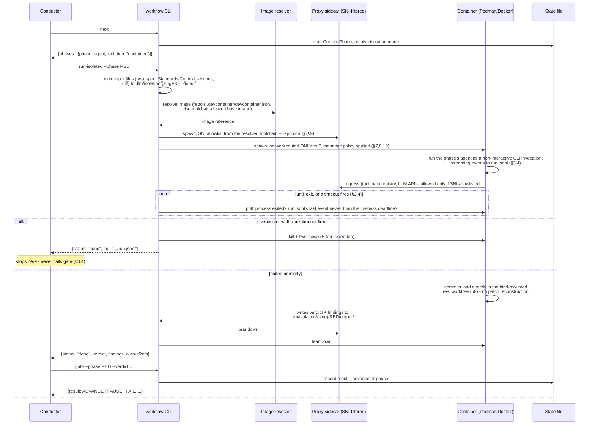

# Isolation — Design Spec

**Status:** Draft, ready for review. Supersedes-in-spirit `.llm/plans/isolation.md`
(the decision log that produced this — kept as the historical record of *why*, not
duplicated here).
**Scope:** Extends the workflow engine (`tools/workflow/`, `workflow/pipelines.yml`,
`.tech-decisions.yml`) described in [workflow/README.md](./README.md) with a
per-phase isolation boundary. Read that file first — this one assumes its schema
and CLI contract as a starting point and only describes the delta.
**Implementation status (2026-10-23):** §4, §5, §7, §8, §9, §10's narrowing-to-
touched-paths, and §11's resolved baseline are implemented — `pipelines.yml`'s
`isolation` key, `.tech-decisions.yml`'s `isolation` block, `workflow next`'s
extended response, and the new `workflow isolation --override` command all exist
and are tested. **§3's container lifecycle (`workflow run-isolated` itself) is
designed but not implemented.** The mechanism decisions that were blocking it are
now resolved — §9's network enforcement (an SNI-filtered proxy sidecar, not
iptables/DNS filtering), the lifecycle tool (raw Podman/Docker CLI, not the Dev
Containers CLI), the sandboxed subagent's own LLM-API credential handling (§7),
resource quotas (§6, pulled forward from a deferred non-goal), and liveness/hung
detection (§3.4, a gap found after Phase 1 shipped). §3.4's own open question —
whether the container's `claude` invocation can be configured so no tool can
block on interactive input — is now independently verified against Claude Code's
actual documentation, not assumed; the exact entrypoint invocation is written
into §3.4. What's left is building it: until `run-isolated` exists, a phase
resolving to `container` has nowhere to actually run — `next` reports the
resolved mode correctly, but nothing yet acts on it.

## 1. Goals and threat model

Isolation exists to contain three things at once, and to make a specific tradeoff
safe in exchange:

- **Buggy subagent damage** — an unintended destructive command, a test that hits a
  real external service instead of a mock, an overwrite outside the intended scope.
- **Adversarial content in the target repo** — this tooling's agents run against
  arbitrary repos this project doesn't control. A planted file, commit message, or
  branch could attempt to manipulate a subagent into harmful action (prompt
  injection) or simply *be* the harmful action once executed (a malicious build
  script).
- **Supply-chain risk from invoked tooling** — a package manager install, linter, or
  build tool run during a phase executes code this project never wrote and can't
  review in advance (postinstall scripts, compromised registries).

The tradeoff this buys: because worst-case damage per phase is bounded by a real
enforced boundary — not a tool-allowlist convention — the Conductor can be trusted
with more autonomy than it has today: fewer `pauseWhen` gates for pure process-risk
concerns, longer unattended runs, and tool/network grants that would be unsafe to
hand a fully-trusted-by-default subagent.

**The boundary must hold even when the agent itself is fully convinced to do the
wrong thing.** It cannot rely on the subagent's own cooperation, and it cannot rely
only on restricting which Claude Code tools are exposed to the model — a malicious
`postinstall` script run by `npm install` never goes through a Claude Code tool call
at all, so a tool allowlist can't contain it. This is why the mechanism is a real
sandbox (§3), not an extension of the `tools:`/`disallowedTools` allowlists that
already exist on every agent file — those remain in place and complement this, they
don't substitute for it.

## 2. Non-goals (explicitly deferred, not forgotten)

- **Dotfile/secret-path exclusion within the repo itself** (e.g. hiding `.env`,
  `.git/config` from read access even inside the task's own worktree). A future
  tightening of §10's filesystem policy, not required for a first version.
- **Fine-grained per-call auditing of commands run inside the sandbox.** The
  boundary is preventive (deny by default), not detective. Logging/audit of what
  actually ran is useful but is a separate feature.

## 3. Architecture

### 3.1 Two dispatch paths, selected per phase

Every phase resolves to exactly one of:

- **`direct`** — unchanged from today. The Conductor dispatches the phase's agent
  via the `Task` tool, in-process, sharing the Conductor's own session. This is
  "no change" for `SPEC_REVIEW_GATE`, `SECURITY`, `DOCUMENT`, `VERIFY` (software) and
  `SECURITY`, `VERIFY` (infrastructure).
- **`container`** — the phase does **not** go through the `Task` tool at all. The
  workflow engine itself — a script, not an LLM decision — materializes the phase's
  inputs to files, spawns a sandboxed, non-interactive agent invocation inside a
  container, waits for it to finish, and reads its outputs back from files. The
  Conductor's role for a `container` phase shrinks to "ask the engine to run this
  phase and wait," exactly the same shape as it already asks the engine `next`/
  `gate` questions — it is not told *how* that happened, only the result.

This second path is what actually satisfies "no LLM for orchestration" for the
phases that need it: the thing deciding to spawn the subagent and tearing it down
afterward is the engine's own script, not the Conductor reasoning about whether to
call `Task`.

**Resolved (2026-10-23): the engine drives Podman/Docker directly — `podman run`/
`docker run` invoked from `workflow.sh`/`.ps1` — not the Dev Containers CLI.** The
Dev Containers CLI (`devcontainer up`/`exec`) would parse `devcontainer.json` for
us, but it's a Node.js tool on top of the container runtime (a second new
dependency beyond what §11 already accepted), and its defaults — SSH-agent
forwarding, a read-write workspace mount — are built for a trusted interactive
session. We'd spend as much effort disabling its defaults as writing the `podman
run`/`docker run` invocation ourselves, and a raw invocation gives one consistent
code path for both "repo has a `devcontainer.json`" and "derive an image from
`.tech-decisions.yml`'s toolchain" (§12) instead of branching into two different
tools. We still *read* `devcontainer.json`'s `image`/`build`/`features` fields —
just not via that CLI.

### 3.2 Sequence for a `container` phase



`direct` phases skip all of this and keep today's sequence exactly
(`workflow/README.md`'s existing diagram) — the Conductor dispatches via `Task`
directly, no new file layout, no container.

### 3.3 Why the real worktree is bind-mounted, not copied

The container mounts the task's **actual** git worktree, not an ephemeral copy. A
subagent's commits inside the container are real commits in the real history,
preserving this repo's commit-per-phase and commit-message-format discipline. This
was chosen over having the subagent emit a patch for the host to re-apply, because
the patch approach costs real complexity (reconstructing commit granularity and
messages) for a security gain the credential-stripping and network-denial layers
(§7, §9) already provide without it — `git push` is blocked whether or not the
container ever touched the real worktree directly.

### 3.4 Liveness, timeouts, and the `hung` status

**Resolved (2026-10-23).** Found after Phase 1 shipped: nothing upstream of this
spec addresses how the orchestrator or a human tells a working-but-slow
in-container agent apart from one that's hung — and since dispatch is headless,
there's no human to answer even if the agent somehow reached a state where it
would otherwise ask one.

**Mechanism:** the container's entrypoint runs the phase's agent through Claude
Code's non-interactive streaming output mode (`--output-format stream-json
--verbose --include-partial-messages`) and pipes that event stream to a log file
on a bind-mounted, host-visible path (`.llm/isolation/{slug}/{phase}/run.jsonl` —
outside the otherwise-isolated container filesystem specifically so a human can
`tail -f` it directly, and so `run-isolated`'s own poll loop can read it without
exec-ing into the container). Liveness is judged by **when the log file last
received a new line**, not wall-clock ticks and not CPU/network activity —
watching the real event stream is the only signal that actually distinguishes
"new work is happening" from "the process is merely still running," which a
process-alive check or a resource-usage heuristic cannot: a stuck loop can look
100% alive and busy while producing nothing, and a model call waiting on network
latency can look idle while working fine. (Confirmed directly against
`headless.md`: individual stream events don't carry a documented wall-clock
timestamp field, so watching the log's own write activity is necessary, not just
one of several equally good options.)

Claude Code's own `-p` mode has a separate, narrower built-in idle-wait cap worth
noting but not relying on here: by default it stops waiting on still-running
*background* work (background Bash commands, subagents, Monitor watches) after
10 minutes of continuous idle waiting once the model's own turn has ended
(`CLAUDE_CODE_PRINT_BG_WAIT_CEILING_MS`). That's a different thing from what
this section detects — a foreground tool-call loop that never reaches a turn
boundary at all isn't "idle background work," so this native cap doesn't
substitute for the liveness/wall-clock tiers below.

**Two independent timeout tiers**, both enforced by `run-isolated`'s own poll
loop (§3.2's `loop...end` block) — not handed back to the Conductor mid-wait:

- **Liveness timeout** (short): no new event in `run.jsonl` for N minutes → the
  phase is `hung`. Catches a genuinely stuck agent fast, rather than waiting out
  the full ceiling below for something that will never resolve on its own.
- **Wall-clock ceiling** (long): the absolute cap on this phase's elapsed time,
  regardless of liveness. Pairs with the CPU/memory/`pids-limit` quotas in §6 —
  one bounds elapsed time, the other bounds resource burn per unit time.

Either firing kills the container (and its proxy sidecar) and reports
`{"status": "hung", "log": ".../run.jsonl"}`.

**Contract with the Conductor:** `hung` does not fit the existing `pauseWhen`
vocabulary (`spec-gap`, `blocked`, `safety-critical-survivor`,
`formal-counterexample`, `critical-finding`, `fail`) — those all presume the
agent *responded* and failed its gate; `hung` means it never did. `run-isolated`
therefore surfaces `hung` as a `status`, distinct from a gate `verdict`, **before**
the Conductor would otherwise call `gate` — the same shape `init`'s `ask` action
already uses (stop immediately, surface the log path, wait for the human) rather
than something routed through `pauseWhen`. `hung` is never phase-configurable; it
always halts, the same way a Kani counterexample or a Critical security finding
always halts today regardless of what a phase's own `pauseWhen` list says.

**The corner case this is really guarding against** (the agent reaching a state
where it would ask a question, with no human to answer) is handled upstream of
detection, not by it — **resolved and verified (2026-10-23) directly against
`headless.md`, not assumed:** passing `--permission-prompts none` doesn't just
deny a call to `AskUserQuestion` if the agent tries it — Claude Code **removes
that tool from the model's available tool list entirely** when the flag is set,
so it can't be called at all, and any MCP elicitation request with no answering
hook is cancelled rather than left pending. Print mode's default behavior (even
without that flag) is already deny-rather-than-wait whenever there's no host to
answer a prompt. There is no code path in headless mode that waits indefinitely
on a question — confirmed, not merely configured defensively. If something still
stalls despite that (a genuine infinite loop in tool calls, not a blocked
prompt), the liveness timeout is the backstop that notices and reports it as
`hung`.

**Two further flags, found during this verification, worth adding to the
container entrypoint for reasons that map directly onto §1's threat model
rather than onto liveness specifically:**

- **`--restricted`** — built for close to this exact scenario ("an evaluation
  harness drives `claude` on a shared machine"). It loads **only managed
  settings and `--settings`**, never a repo's own `.claude/settings.json` —
  closing off the specific vector §1 already names ("adversarial content in the
  target repo... a planted file... could attempt to manipulate a subagent").
  It also confines the built-in file tools to the working directory, refuses
  `bypassPermissions` outright, and strips command-execution tools and
  `WebFetch` unless named explicitly in `--tools` — which GREEN/RED/REFACTOR/
  AUDIT need, so the entrypoint passes `--tools "Bash,Read,Edit"` (or
  whatever the phase actually requires) to restore them deliberately rather
  than inheriting them by default.
- **`--bare`** — skips auto-discovery of the target repo's own hooks, MCP
  servers, and `CLAUDE.md`. Same rationale: repo content this project doesn't
  control shouldn't get to run with the agent's privileges just by existing in
  the checkout.

Combined with §6's resource quotas and the permission flags above, the full
verified entrypoint invocation:

```bash
claude -p "<prompt>" \
  --bare --restricted \
  --permission-mode dontAsk --permission-prompts none \
  --tools "Bash,Read,Edit" --allowedTools "<task-specific allowlist>" \
  --output-format stream-json --verbose --include-partial-messages \
  --max-budget-usd <N>
```

## 4. Phase isolation defaults

Shipped as the baseline in `pipelines.yml` itself (§5.1) — every repo gets these
unless it opts out via `.tech-decisions.yml` (§5.2). See §11 for why this baseline
being the *shipped default* rather than an opt-in needs a decision before release.

| Software pipeline phase | Default | Why |
| --- | --- | --- |
| `SPEC_REVIEW_GATE` | `direct` | Read-only review, no target-repo tooling executed |
| `RED` (Tester) | **`container`** | Writes and runs tests against the target repo's own toolchain |
| `GREEN` (Coder) | **`container`** | Executes arbitrary code/build/install against the working tree |
| `REFACTOR` (Refactor) | **`container`** | Same as GREEN |
| `AUDIT` (QA Engineer) | **`container`** | Runs mutation/fuzz tooling, installs test dependencies |
| `SECURITY` (Security Reviewer) | `direct` | Read-mostly review |
| `DOCUMENT` (Doc Writer) | `direct` | Read-mostly, no toolchain execution |
| `VERIFY` (Verifier) | `direct` | Read-mostly review |

| Infrastructure pipeline phase | Default | Why |
| --- | --- | --- |
| `IMPLEMENT` (Infrastructure Engineer) | **`container`** | Runs `terraform plan`/`apply`, downloads provider plugins, runs `tflint` against potentially tainted inputs |
| `SECURITY` (Security Reviewer) | `direct` | Read-mostly review |
| `VERIFY` (Verifier) | `direct` | Read-mostly review |

## 5. Configuration schema

### 5.1 `pipelines.yml` — per-phase baseline

Each phase entry gains one new key, `isolation`, defaulting per §4:

```yaml
phases:
  - id: RED
    agent: "Tester"
    advance: auto
    pauseWhen: [spec-gap]
    isolation: container   # new — this repo's shipped baseline
```

A phase with no `isolation` key defaults to `direct` — this only needs to be
written explicitly for the five phases in §4 that default to `container`.

### 5.2 `.tech-decisions.yml` — repo-level policy

A new top-level `isolation:` block:

```yaml
isolation:
  mechanism: podman        # optional; "podman" (preferred) or "docker". Engine
                            # detects whichever is installed if omitted.
  overrides:                # repo-level phase-default overrides — committed,
    RED: direct              # reviewable. Can move a phase EITHER direction
                              # at this level (unlike the task-level override
                              # in §5.3, which can only strengthen).
  network:
    allow: []                # additional egress allowlist entries beyond the
                              # toolchain-derived defaults (§9)
```

`overrides` is the only place a phase's `container` default can be weakened to
`direct` — a committed, reviewable config change, never a runtime flag. This is
the repo maintainer's call, not an individual task's.

### 5.3 Task-level override — asymmetric, mirrors `workflow tier --override`

A new command:

```
workflow isolation --phase <id> --override <container|direct> [--pipeline <name>]
```

Resolves the phase's current baseline (pipelines.yml default, after
`.tech-decisions.yml`'s `overrides`), then:

- Requested `container` where the resolved baseline is `direct` → **allowed**
  (strengthening). Recorded in the state file.
- Requested `direct` where the resolved baseline is `container` → **refused
  outright**, same posture as `workflow tier --override`'s refusal to move below
  an `elevated` floor:

  ```json
  {"error": "cannot downgrade RED below repo policy (container)", "rejectedOverride": "direct"}
  ```

  The only way to actually weaken it is editing `.tech-decisions.yml`'s
  `overrides` block — see §5.2.

### 5.4 `workflow next` — extended response shape

```json
{"phases": [{"phase": "RED", "agent": "Tester", "isolation": "container"}]}
```

One new field per phase entry; everything else about `next`'s contract is
unchanged. The Conductor branches on this field: `direct` → dispatch via `Task` as
today; `container` → call `workflow run-isolated` (§3.2) instead.

### 5.5 State file — new per-phase record

Alongside the existing `**Tier:**`/`**Tier Reason:**` lines, one new section
tracking resolved isolation mode per phase and why:

```markdown
## Isolation
RED: container (repo default)
GREEN: container (repo default)
REFACTOR: direct (task override: 2026-10-21, requester judged low risk)
```

Written by the engine on `next`/`run-isolated`, never by the Conductor directly —
same division of responsibility as `Current Phase`/`Phases Done` today.

## 6. `workflow run-isolated` — the new command

```
workflow run-isolated --phase <id> [--pipeline <name>]
```

Only valid when the resolved isolation mode for `<id>` is `container`. Performs the
full sequence in §3.2: materializes input files, resolves the image, spawns the
proxy sidecar and container with the policy from §7–§10 applied, runs its own
poll loop against §3.4's two timeout tiers, tears everything down, and returns
one of two shapes.

**Resolved (2026-10-23) — exact file layout:**

```
.llm/isolation/{slug}/{phase}/
  input/
    prompt.md    # the same assembled markdown Conductor would otherwise inline
                 # into a Task-tool call (Standards/Toolchain/Context/Existing
                 # Work/Diff) -- written to a file instead, not restructured
    task.json    # {id, title, pipeline, phase, branch} -- structured metadata
                 # for the entrypoint script, not for the model
  output/
    verdict.json # {verdict, findings} -- single structured file, not free
                 # text, so run-isolated parses it the same way every time
  run.jsonl      # §3.4's liveness log
```

One combined `prompt.md` rather than one file per context section — nothing
today needs per-section granularity, and splitting it would be complexity with
no consumer. `verdict.json` being structured (not prose `run-isolated` has to
parse heuristically) matters more: it's the one output every phase must produce
correctly for `gate` to work at all.

**Resolved (2026-10-23) — timeout and quota defaults, hardcoded for v1, not a
new `.tech-decisions.yml` block:** liveness timeout 10 minutes, wall-clock
ceiling 60 minutes, `--memory 4g`, `--cpus 2`, `--pids-limit 512`. Growing the
config schema speculatively isn't warranted yet — an override knob is cheap to
add once a real task actually needs one, the same way `tier --override` was
added for a real need rather than upfront.

**Normal completion:**

```json
{"status": "done", "verdict": "CLEAR", "findings": [...], "outputRefs": [".llm/isolation/42-foo/RED/output/"]}
```

**Hung (§3.4) — liveness or wall-clock timeout fired:**

```json
{"status": "hung", "log": ".llm/isolation/42-foo/RED/run.jsonl"}
```

**Resource quotas (§3.4's wall-clock ceiling counterpart), pulled forward from a
deferred non-goal now that this command is actually being built** — applied via
Podman/Docker's native flags, not a separate mechanism:

| Limit | Flag | Purpose |
| --- | --- | --- |
| Memory | `--memory` | Bound worst-case cost; a runaway process is killed by the runtime, not left to exhaust the host |
| CPU | `--cpus` | Same, for CPU burn |
| Process count | `--pids-limit` | Caps fork-bomb-shaped runaway behavior |
| Wall-clock | enforced by `run-isolated`'s own poll loop, not a container flag | §3.4's hard ceiling |

Defaults per the hardcoded values resolved above.

On a missing runtime (§11) or a policy violation detected during the run (e.g. the
subagent's git wrapper rejected a denied command), returns a non-zero exit and a
structured error — never a silent `direct` fallback.

## 7. Credential and secret handling

Never mounted or passed into the container, regardless of what the host session
has available: `.git-credentials`, SSH private keys and `known_hosts`,
`GITHUB_TOKEN`/`GH_TOKEN`/`GH_PAT`-shaped environment variables, `gh` CLI auth
state, any cloud-provider credential files (`~/.aws`, `~/.azure`, provider env vars
for the infrastructure pipeline). This is independent of and redundant with the
network policy (§9) and git policy (§8) — removing credentials means even a
reachable, allowlisted host has nothing to authenticate with.

**Resolved (2026-10-23) — the one deliberate exception.** The containerized
agent needs *some* credential to make its own LLM calls at all; "no credentials"
can't literally apply to it. Scoped as tightly as the auth mechanism allows
(a short-lived/scoped token where the mechanism supports one, not a long-lived
key blanket-copied from the host), and routed through §9's SNI-filtered proxy
like every other egress — meaning the sandbox's network can reach *only* the
LLM API domain plus the toolchain registries. Even if this one credential were
exfiltrated via some other channel, the sandbox it came from still can't use the
network to send it anywhere outside that allowlist — it's only usable for what
it's already authorized to do from inside.

## 8. Git policy

**Allowed** (read-only introspection, and local file-level mutation on the task's
own already-checked-out branch):

```
status, diff, log, show, blame, ls-files
add, commit, stash, restore, checkout -- <path>
```

**Denied**:

```
push, fetch, pull, remote (add|set-url|remove)
checkout/switch to any ref other than the task's own branch
branch -f, branch -D
```

Enforced by a wrapper the container's `git` resolves to, not by convention — a
bind-mounted worktree still shares the host repo's `.git` object/ref database, so
filesystem confinement alone does not prevent `git checkout main` from succeeding
inside the container unless this list is actively enforced.

**Finding, folded into the wrapper rather than listed as a separate denial:**
`core.hooksPath` can point at a tracked directory inside the repo (a legitimate,
common convention — e.g. `.githooks/`) rather than the untracked, local-only
`.git/hooks/`. If it does, an otherwise-harmless allowed command like `git
commit` would execute whatever hook script the target repo's own tracked tree
names — which is exactly the "adversarial content in the target repo" vector §1
already names, reached through a command this policy otherwise permits. The
wrapper forces `-c core.hooksPath=/dev/null` on every invocation, unconditionally,
regardless of what the repo's own config says — harmless for the read-only
commands, and closes this for `commit` without needing a separate check.

## 9. Network policy

**Default-deny, with a toolchain-derived allowlist, repo-adjustable.**

**Resolved (2026-10-23) — enforcement mechanism: an SNI-filtered forward-proxy
sidecar, not iptables/DNS filtering.** The container is given no direct route to
the internet at all — its only reachable network peer is a per-run proxy sidecar
(§3.2). The proxy inspects each outbound TLS connection's ClientHello **SNI
field** and allows or drops the connection by hostname **without decrypting it**.
Nothing is MITM'd, so no CA certificate needs injecting into whatever trust
store `cargo`/`npm`/`pip` already uses — they see a normal, unintercepted TLS
connection to the real host. This was chosen over DNS-resolution-plus-dynamic-
`iptables`/`ipset` rules because the proxy approach is itself just another
container, with the same behavior on Docker Desktop (confirmed available in this
environment) and native Linux Podman alike — the iptables/ipset alternative
means manipulating kernel netfilter state inside whatever network namespace the
runtime happens to give you (Docker Desktop's WSL2 VM, or Podman rootless
`slirp4netns`/`pasta`), which is real surgery that's easy to get subtly,
silently wrong per-platform.

**Resolved (2026-10-23) — proxy software: Squid, in `ssl_bump splice` (SNI-
sniffing passthrough) mode, not Envoy and not a custom implementation.** Envoy
is built for L7 service-mesh routing — more configuration surface than a plain
allow/deny-by-SNI sidecar needs. A custom implementation means this project
writing and trusting its own TLS ClientHello parsing, which is exactly the kind
of security-adjacent code to reuse an audited tool for rather than author from
scratch. Squid's `ssl_bump splice` ACLs are a direct, well-documented fit:
inspect the SNI, splice (pass through unmodified) if allowed, drop otherwise.

Default allowlist entries come from the resolved toolchain (reusing
`.tech-decisions.yml`'s existing `toolchains` resolution, computed today for
`workflow context`/`workflow tier`):

| Toolchain | Default allowlist |
| --- | --- |
| Rust | `crates.io`, `static.crates.io`, `index.crates.io` |
| Node | `registry.npmjs.org` |
| Python | `pypi.org`, `files.pythonhosted.org` |
| *(others added as toolchains are added to `.tech-decisions.yml`)* | |

Plus, unconditionally, the LLM API domain the containerized agent itself needs
(§7's credential exception) — not toolchain-derived, always present.

A repo extends this via `.tech-decisions.yml`'s `isolation.network.allow` (§5.2) —
e.g. a private registry mirror. Being on the allowlist never implies git push
authorization — §7/§8 hold regardless of what's reachable.

## 10. Filesystem policy

**Ceiling:** confinement to the task's own worktree — no access to the host home
directory, other repos, or anything outside the repo root. Non-negotiable baseline.

**Narrowed further:** `workflow tier`'s existing `--path` input (every file/module
the task is expected to touch, computed today only to check against
`.tech-decisions.yml`'s `risk_paths`) doubles as the writable-mount policy for
free — the declared touched paths are mounted read-write, the rest of the repo
read-only. No new input to compute; reuses what `workflow tier` already resolves
when the Conductor runs it in Step 2b.

## 11. Degradation behavior — and the rollout decision

When a phase resolves to `container` and the required runtime (Podman, falling
back to Docker) isn't present on the host, `workflow run-isolated` hard-fails with
install instructions — never a silent fallback to `direct`. Same posture as the
global installer's symlink rejection and `tier --override`'s refusal: fail loudly,
let the human decide, never silently degrade a safety property.

**Resolved (2026-10-22): (a) — ship §4's table as the default baseline directly in
`pipelines.yml`, no opt-in inversion.** The breakage concern that motivated option
(b) doesn't apply: this feature has no existing adopters yet, so there is no
upgrade path to protect. The first repo to pick up this version of
`pipelines.yml` is also the first repo to use isolation at all — "shipping a
breaking default" and "shipping the feature" are the same event. §5.2's
`.tech-decisions.yml` `overrides` block stays an opt-*out* mechanism as originally
specified, not an opt-in one. Revisit this choice if the feature ships once and
then needs a second, genuinely-breaking default change later — that case would
have real adopters to protect and the (a)/(b) tradeoff above would apply for real.

## 12. Devcontainer reuse for toolchain provisioning

If the target repo ships `.devcontainer/devcontainer.json`, its `image`/`build`
definition is reused to resolve the container's toolchain — avoiding a parallel
language-to-image mapping scheme in this tooling. Where absent, a minimal base
image is derived from `.tech-decisions.yml`'s existing `toolchains.detect`/
`toolchains.default` resolution.

**Hard rule:** reusing a devcontainer definition for toolchain provisioning only
pulls its `image`/`build`/`features` configuration. It **never** inherits that
devcontainer's own mounts, SSH-agent forwarding, or Docker-socket passthrough —
§7–§10's policy is applied unconditionally on top, overriding whatever the
repo's own `devcontainer.json` configured for its (trusted, interactive) human
users. A repo's devcontainer must not be able to silently defeat this spec's
sandbox by granting access back in.

## 13. Open items

- Dotfile/secret-path exclusion within the repo (§2, §10) — follow-up tightening.
  The only item remaining here; everything else previously listed (file layout,
  proxy software, timeout/quota defaults) is resolved as of 2026-10-23 — see
  §6 and §9.
